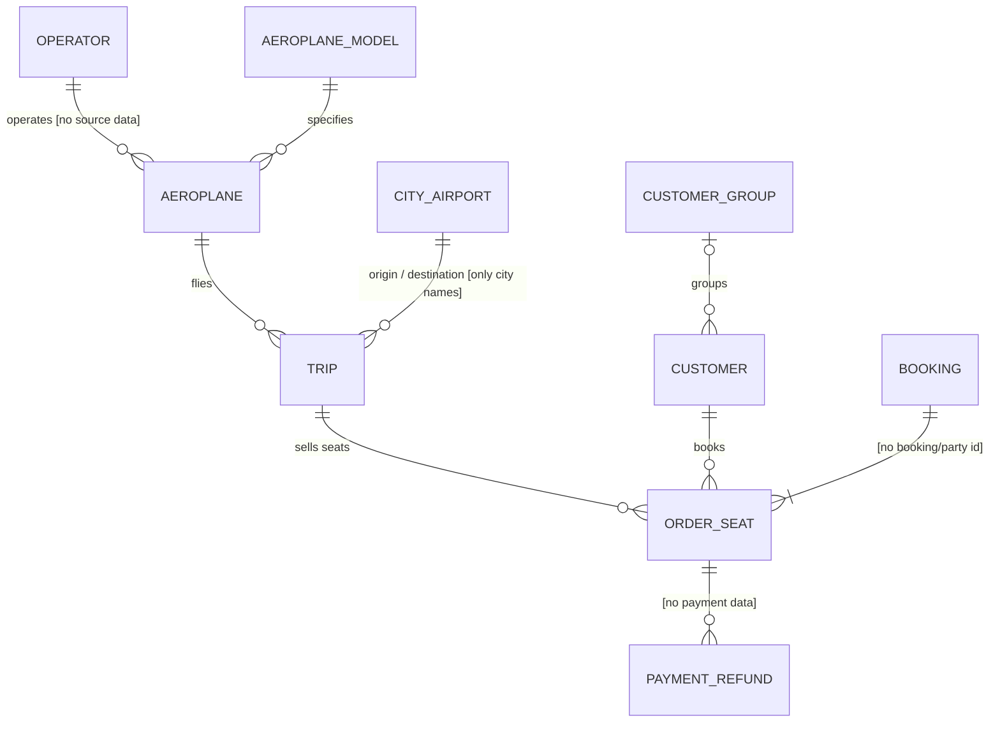
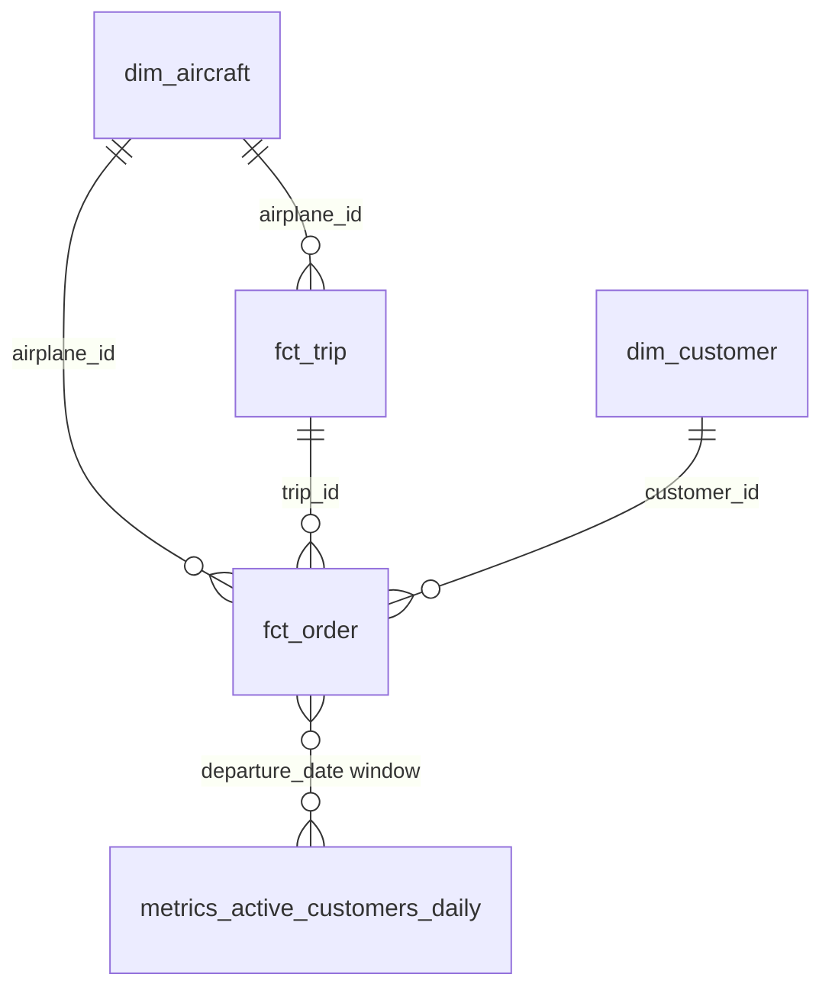

# Air Service analytical data model

Uber Air is a marketplace connecting aeroplane operators with individuals and groups who need transport.
This document describes the source data, the conceptual model, the implemented dbt subset, KPI
definitions, what the model can and cannot answer, and a CI/CD proposal. It is kept in sync with
`models/` and `tests/`.

## 1. Source data and provenance

The six supplied files were taken byte-for-byte, by exact path, from the supplied-artifact location
(`take-home/air-service` branch of this repository; no other file from it was used). They are stored
unchanged in `data/` and loaded unchanged into `prod.raw` by
`just load-raw`. CSV headers keep their original names (Delta column mapping). The JSON lands as a
single text row (`value`) and is parsed in dbt.

| File in `data/` | Supplied as | Git blob SHA | SHA-256 | Raw table |
|---|---|---|---|---|
| `aeroplane.csv` | `data/aeroplane.csv` | `402702e7399aa6dc4f8fceb26c3ce237f7e9359c` | `5fd67ad4b9bc3f087666a6df8e0b729a374f16c3c1f5403a6a9035a85102883f` | `prod.raw.aeroplane` |
| `aeroplane_model.json` | `docs/aeroplane_model.json` | `b7497d30c6c3b55910738560f5f3817119a5864c` | `b91a1b319b31aa00e27de8f93aef382db11c8843b9eae865098ea5c8b4d499c8` | `prod.raw.aeroplane_model` |
| `customer.csv` | `data/customer.csv` | `04a2c70fe3be20ec1d86aee90d153956ea7053f4` | `50b82b662d141cf8c8c0d20503256ea7bb7b61f2580665889026397402fde36d` | `prod.raw.customer` |
| `customer_group.csv` | `data/customer_group.csv` | `8ed21ed6c8f0e4cad13ae24a111a078a65244a0d` | `ac81a3e4e860bf0a5d83222165dec95eeebf3857d0111e213a850b81aa8f48b7` | `prod.raw.customer_group` |
| `order.csv` | `data/order.csv` | `fc7056908558b3ca31d29f74a99a67297cdc2d16` | `288d01fbfe1a6293bd62936c05c96370768c543979e0da579405b684403eb237` | `prod.raw.order` |
| `trip.csv` | `data/trip.csv` | `97b7f5f24bc6e6b53891ab9d2f862d0b43b7501a` | `0ac9c2c302fc5e9fe74b1d81dc5d8d9dfbc373e6fec47a72748a8bd40ba557af` | `prod.raw.trip` |

## 2. Source profile

All figures come from Spark SQL on `prod.raw` (the same numbers are asserted by the dbt tests).

| Table | Rows | Grain / key | Profile findings |
|---|---|---|---|
| aeroplane | 10 | `Airplane ID`, unique | 6 distinct models (3× 737-800, 3× CRJ900, A320neo, E190-E2, G650, 787-9). Every (manufacturer, model) exists in the JSON catalogue. No operator column. |
| aeroplane_model (JSON) | 19 models | (manufacturer, model) | 9 manufacturers. `max_seats`, `max_weight`, `max_distance`, `engine_type`. Units not stated (values match kg MTOW and nautical miles). 13 models are not in the fleet. |
| customer | 20 | `Customer ID`, unique | `Customer Group ID`: 6 NULL (no group), 7 valid, **7 reference group IDs 6–10 that do not exist**. Email: 2 NULL, 17 right-padded with spaces, the 18 present are unique. Phone: 3 NULL, inconsistent formats. Names unique. |
| customer_group | 5 | `ID`, unique | Types: Company (3), Private Group (1), Organisation (1). `Registry number` NULL for the private group; mixed numeric/alphanumeric, so typed as string. |
| order | 20 | `Order ID`, unique | One seat per order. Status: Finished 13 (EUR 18,900), Booked 5 (EUR 9,900), Cancelled 2 (EUR 1,400). Price EUR 500–2,500, all positive, integers. All customer and trip references resolve. No duplicate seat per trip. **Every customer has exactly one order.** No order/booking timestamp. |
| trip | 20 | `Trip ID`, unique | Departures 2024-08-01 to 2024-08-28 (one month). 20 distinct routes, 20 origin and 18 destination cities, no country or airport. Each aeroplane flies exactly 2 trips. All aeroplane references resolve. Timestamps have no time zone; **trips 3 and 9 arrive before they depart** (local wall-clock times across the date line). |

Demand coverage: only trips 2–10 have orders. 12 of 20 trips (1, 5, 11–20) have zero orders, and trip 3
has only cancelled orders. All 5 Booked orders sit on trips 6, 8, 9 and 10, which also have Finished
orders, so their status is probably stale (snapshot date unknown).

## 3. Conceptual model

The full business domain, with the implemented subset marked. Entities in brackets have no source data.

## 4. Implemented model (ERD and grains)

DAG: `prod.raw.*` → `stg_*` (one per source, typed and renamed, no business logic) → marts.

| Model | Grain (key) | Rows | Analytical consumer |
|---|---|---|---|
| `stg_aeroplane`, `stg_aeroplane_model`, `stg_customer`, `stg_customer_group`, `stg_order`, `stg_trip` | one row per source record / JSON model | 10, 19, 20, 5, 20, 20 | Typed source contract; source-grain tests |
| `dim_aircraft` | one row per aeroplane (`airplane_id`) | 10 | Aircraft-type slicing; seat capacity |
| `dim_customer` | one row per customer (`customer_id`) | 20 | Customer / customer-group slicing |
| `fct_trip` | one row per trip (`trip_id`), zero-demand trips included | 20 | Supply, routes, load factor, revenue by route/aircraft |
| `fct_order` | one row per order = one seat (`order_id`) | 20 | Demand, price, status, customer/group analysis |
| `metrics_active_customers_daily` | one row per calendar day (`activity_date`), first to last departure | 28 | DAU / WAU / MAU monitoring |

Cardinality: `fct_order` → `fct_trip`, `dim_customer`, `dim_aircraft` are all many-to-one, so joining
dimensions to `fct_order` never fans out. Trip-level measures are only in `fct_trip`; `fct_order`
carries trip descriptors (route, departure date, aircraft) so seat-level analysis needs no join to
`fct_trip`. Do not sum `fct_trip` measures after joining it to `fct_order`.

Design decisions:

- Two facts at two grains rather than one mixed-grain fact. Supply (trips, seats offered) exists without
  demand, so `fct_trip` keeps every trip and aggregates orders to trip grain.
- Customer-group attributes are denormalised into `dim_customer` (5 groups, no history). Unresolved group
  references are kept: `customer_group_id` stays as supplied and `customer_group_reference_status` is
  `unknown_group_reference`. They are not merged into "no group".
- Email and phone number are profiled but not modelled: no analytical consumer needs PII.
- No operator, region, distance, fare class or segment columns are derived: the data does not support them.
- All models are Delta tables in `prod.analytics` on MinIO. Full refresh is used: the sources are small
  full snapshots without change timestamps, so an incremental merge has no reliable watermark.

## 5. KPI definitions

| KPI | Definition | Where |
|---|---|---|
| Time attribution | Every order and trip metric is attributed to the trip's **local departure date** (`departure_date`). Orders have no timestamp of their own. | `fct_trip`, `fct_order` |
| Active order / active seat | Order with status `Booked` or `Finished` (`is_active`). One order = one seat. | `fct_order.is_active`, `fct_trip.active_seats` |
| Booked / finished / cancelled seats | Count of orders by status. | `fct_trip` |
| Gross booking value (GBV) | Sum of `price_eur` of active orders. Customer-paid value, not Uber Air revenue. | `gross_booking_value_eur` |
| Realised revenue proxy | Sum of `price_eur` of `Finished` orders. No take rate, fees, refunds or accounting recognition exist in the data. | `realized_revenue_proxy_eur` |
| Cancelled value | Sum of `price_eur` of `Cancelled` orders. | `cancelled_value_eur` |
| Seats offered | Aircraft model `max_seats` per trip (catalogue maximum, not actual cabin layout). | `fct_trip.seat_capacity` |
| Load factor | `active_seats / seat_capacity` per trip; across trips use `SUM(active_seats) / SUM(seat_capacity)`. | `fct_trip.load_factor` |
| Average price per active seat | `SUM(gross_booking_value_eur) / SUM(active_seats)` (derive in queries). | `fct_trip`, `fct_order` |
| Cancellation rate | `SUM(cancelled_seats) / SUM(orders)`. | `fct_trip` |
| Active customer | Customer with ≥ 1 active order on a trip departing in the window. | `metrics_active_customers_daily` |
| DAU / WAU / MAU | Distinct active customers for the day / trailing 7 days / trailing 30 days ending on `activity_date`. Not additive across days. `is_complete_7d_window` / `is_complete_30d_window` flag windows that start before the data. | `metrics_active_customers_daily` |

Reconciled totals (2024-08 data): 20 trips, 2,920 seats offered, 20 orders, 18 active seats, GBV
EUR 28,800, realised revenue proxy EUR 18,900, cancelled value EUR 1,400 (GBV + cancelled = raw price
total EUR 30,200), overall load factor 0.62 %. Peak WAU 12; MAU 18 from 2024-08-15 (no 30-day window
is complete in 28 days of data).

## 6. Assumptions

- `Finished` = the seat was flown; `Booked` = seat held, not yet flown; `Cancelled` = seat released.
- NULL `Customer Group ID` means the customer belongs to no group.
- Trip timestamps are local wall-clock times at origin (start) and destination (end), time zone unknown.
  They are stored as `TIMESTAMP_NTZ`; no duration is derived.
- `price_eur` is the seat price paid by the customer, in EUR, also recorded for cancelled orders.
- Aeroplane model specification is a catalogue maximum; actual seat configuration is unknown.
- The dataset is a single snapshot; dimension attributes are current values, not history.

## 7. Known source defects and how they are surfaced

Known defects are tested with `warn_if: ">0"` and `error_if` set to the known count: every run shows them
as warnings, and any new occurrence fails the build.

| Defect | Rows | Handling | Test |
|---|---|---|---|
| Customer references non-existent group IDs 6–10 | 7 customers | Kept, flagged `unknown_group_reference` | `relationships` on `stg_customer.customer_group_id` (warn 7, error > 7) |
| Arrival before departure (local times, no zone) | trips 3, 9 | Kept, flagged `is_end_before_start` | `assert_trip_end_not_before_start` (warn 2, error > 2) |
| Booked orders on trips that already have Finished orders (stale status) | orders 7, 9, 13, 16, 19 | Kept as Booked (active, not realised) | `assert_no_booked_orders_on_finished_trips` (warn 5, error > 5) |
| Padded emails, missing email/phone, mixed phone formats | 17 / 2 / 3 | Not modelled (PII) | — |

## 8. Requirements coverage

| Business question | Status | What the model provides | Data needed to close the gap |
|---|---|---|---|
| Regional growth drivers | Partial | Trips, seats, GBV, load factor by origin / destination city and route | City → country / region reference (IATA airports); more than one month of history; order creation dates |
| Customers / groups served well | Partial | Orders, active seats, GBV, cancellations by group type, group, and reference status | Satisfaction / NPS, on-time performance, cancellation reasons, repeat bookings (every customer has 1 order) |
| Origin / destination | Yes | City pair on every trip and order | Airport codes for disambiguation |
| Short / long haul | No | Local start/end timestamps, `is_end_before_start`, aircraft `max_distance` (capability, not route) | Airport coordinates or route distance, or UTC timestamps |
| Low-cost / premium | No (no label) | Seat `price_eur`, aircraft model | Fare class / cabin / product tier; distance to normalise price |
| Group / seat size | Partial | 1 order = 1 seat; seats per customer group per trip from `fct_order`; aircraft `max_seats` | Booking / party ID that ties seats bought together |
| Aircraft type | Yes | Manufacturer, model, seats, engine via `dim_aircraft` on both facts | Operator, actual cabin configuration |
| DAU / WAU / MAU | Yes (proxy) | `metrics_active_customers_daily`, departure-date attribution | App/search/booking event timestamps for true usage activity |
| Revenue and comparable metrics | Partial | GBV, realised revenue proxy, cancelled value, load factor, price per seat | Take rate / commission, refunds, costs; distance for RASK-style metrics |

## 9. Defence: what the model answers and what it does not

The model answers, reconciled to source: how much supply was offered and sold per trip, route,
city and aircraft type (including unsold trips); who bought (customer, group, group type, unresolved
group); what customers paid, by status; how many customers were active per day, week and month under
an explicit definition.

It does not answer distance-based questions (short/long, revenue per seat-km), premium versus low-cost,
regional roll-ups, operator performance, true app usage, net revenue, or service quality. Inventing
thresholds or labels for these would produce numbers that look precise but have no source behind them.
The raw measures needed for later classification are exposed, and section 8 lists the data that
would close each gap.

The data volume (20 orders, one month, one order per customer) supports demonstrating the model's logic
and tests, not drawing business conclusions.

## 10. Limitations and future work

- Add a city/airport reference (country, region, coordinates, time zone) to unlock regional roll-ups,
  distance bands, UTC durations and RASK.
- Add order event timestamps (created, cancelled, flown) and keep status history (snapshot or CDC) to
  attribute bookings to booking date, measure lead time, and resolve stale `Booked` statuses.
- Add an operator entity and link aeroplanes to it for supply-side marketplace metrics.
- Move to incremental `merge` models keyed on `order_id` / `trip_id` once sources carry change timestamps.
- Add dbt model contracts on marts and dbt unit tests for KPI logic as the model grows.
- Add a semantic layer (metrics definitions) once more than one BI consumer exists.

## 11. CI/CD proposal

### Ideal environment

1. Pull request: `just ci` (dbt parse + sqlfluff) in seconds, then slim CI: `dbt build --select state:modified+
   --defer --state <prod manifest>` into an isolated per-PR schema on a Databricks SQL warehouse
   (or the Docker stack). Error-severity tests block merge; warn tests are reported in the PR.
2. Data diff on changed marts against production (row counts, key KPIs such as GBV and DAU) posted to
   the PR.
3. Merge to `main`: deploy with write-audit-publish: build into a staging schema, run all tests and
   reconciliations, then swap into `prod.analytics`. Store the manifest for the next slim CI run.
4. Scheduled production runs (orchestrator or Databricks Jobs) with source freshness checks, alerting on
   test failures and on warn counts that change, and published dbt docs.

### Resource-constrained environment

1. Every pull request: one GitHub Actions job running `just ci` (no Docker, about 1 minute).
2. On merge to `main` and nightly: `just verify` on a standard runner with Docker (clean stack, load raw,
   seed/run/test, MinIO storage and restart checks), caching the Spark image.
3. Production: a single scheduled `dbt build` (cron on one VM or a small job cluster); a failing
   error-severity test stops the run and notifies by email or chat.
